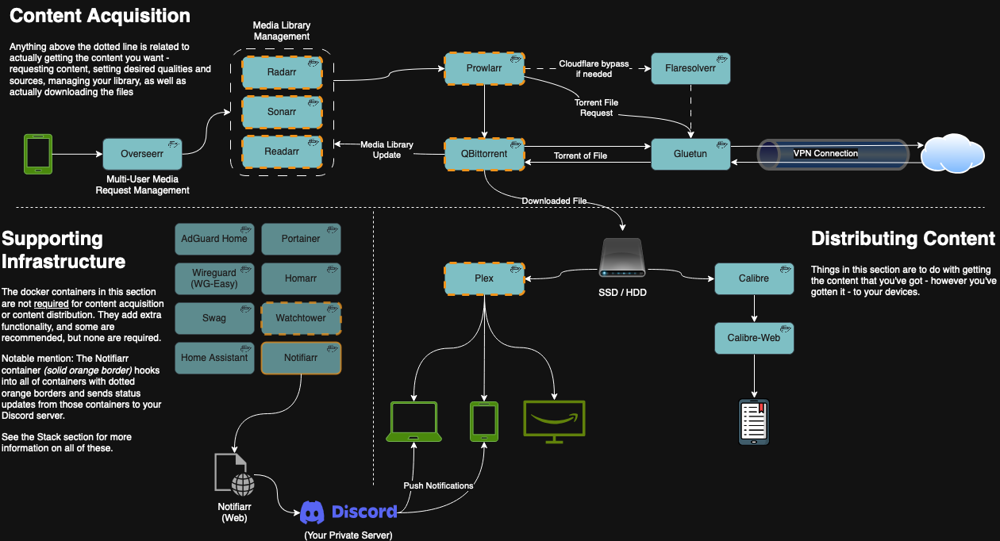
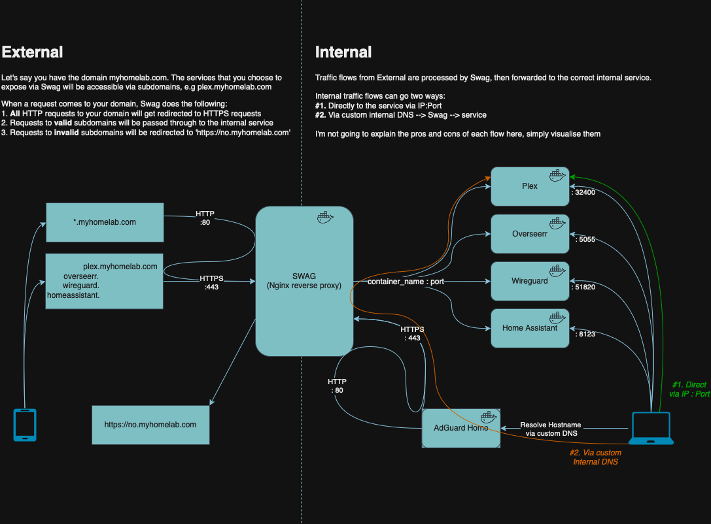

# Architecture
I've put this in before describing the components in more detail as I think having a visual representation of what's going on helps promote understanding more than, well, a wall of text.

First, the data flow in the context of interactions between the containers themselves:

Second, the data flow in the context of the homelab as deployed to your home network, and accessed in and out of your home:

